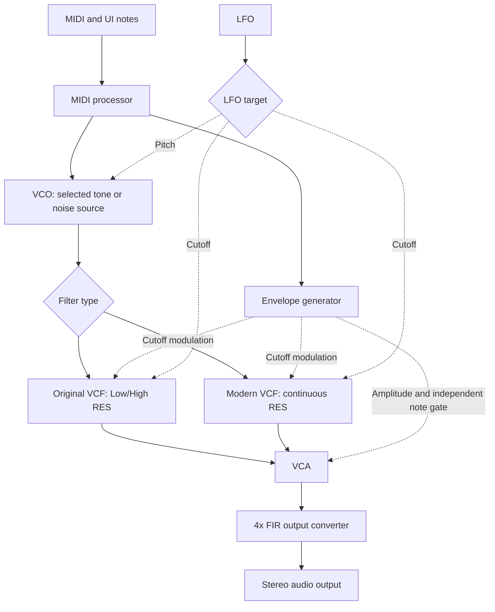

# CheapSynth01

CheapSynth01 is an iPlug2-based software emulation of an early 1980s compact
monophonic synthesizer. It combines circuit-informed modeling with provisional
DSP approximations where hardware characteristics remain unresolved.

## Features

- Five tonal waveforms: Triangle, Sawtooth, Square, Pulse and PWM, plus white noise
- Octave selection, discrete glissando, independent PWM speed and LFO modulation
- Two filter models with different resonance controls:
  - Original VCF: two-pole behavioral model with Low/High resonance
  - Modern VCF: four-pole behavioral model with continuous resonance
- Stateful ADSR envelope, independent VCA note gate, asymmetric pitch bend and breath control
- Six factory sounds transcribed from the CS01 owner's manual, plus an initialization patch
  ([panel settings and usage](docs/Factory-presets.md))
- User XML presets, XML import, and DAW session state
- CS01-inspired panel with standard iPlug2 controls, optional on-screen keyboard,
  PC-keyboard playing and output scope
- Standalone audio/MIDI device preferences
- Four-times internal processing with a linear-phase FIR output converter

## Supported Platforms and Formats

| Product | Windows | macOS |
| --- | --- | --- |
| Standalone application | Yes | Yes |
| VST3 | Yes | Yes |
| CLAP | Yes | Yes |
| AUv2 | — | Yes |

Development and CI target Windows and macOS. Linux and LV2 are no longer supported.

## Usage

Launch the standalone application or load the appropriate plugin on an instrument
track in your DAW. In standalone, open Preferences to choose the audio output and
MIDI input. Plugin formats use the DAW's device settings.

Play from a MIDI device or enable **KEYBOARD + MONITOR** for the on-screen keyboard,
PC-keyboard input and output scope. CheapSynth01 plays one note at a time, with
highest-note priority when several notes are held. Select a factory sound in
**MEMORY**, or save your own sound as an XML preset.

The [user guide](docs/User-guide.md) covers controls and defaults, keyboard keys,
standalone settings, presets, session behavior and troubleshooting. See also the
[MIDI implementation](docs/MIDI-Implementation.md) for controller assignments.

## Signal Flow Architecture

The framework-independent `SynthEngine` owns the sound generators, MIDI processor,
EG, LFO, both filters and VCA. The iPlug2 wrapper handles host callbacks, parameters,
state and the editor; it does not use JUCE's AudioProcessorGraph.

The engine selects one filter and one LFO destination within a fixed processing
order. Tone/noise generation, modulation, filtering and amplification run at four
times the host sample rate. A linear-phase FIR converter produces the host-rate
output, with 16 host samples of reported latency. Mono synthesis is duplicated to
stereo at the output.

### Audio and Control Paths

- **Sound generation:** Feet selects the tonal octave or white noise; Waveform
  selects the tonal shape. The selected source continues running while the VCA is silent.
- **Filtering:** Filter I selects Original; Filter II selects Modern. EG, LFO and
  breath control can modulate cutoff. Both modes keep the panel label **RES**.
- **Amplification:** VCA EG Depth blends note-gated level with envelope-controlled
  gain. An independent note gate keeps idle output silent even at zero EG depth;
  breath sensitivity and Volume also affect level.
- **Envelope:** Retriggers preserve residual state. Editing the active stage's
  time changes its remaining duration without restarting the envelope.
- **Routing and MIDI:** Filter/LFO selections and complete preset changes reach
  the engine at audio block boundaries. MIDI events retain their sample offsets,
  and held notes use highest-note priority.

The core is in [CheapSynth01/core](CheapSynth01/core), and the iPlug2 wrapper/editor is in
[CheapSynth01](CheapSynth01). See [MIDI control flow](docs/MIDI-realtime-control.md)
and [host presets and state](docs/iPlug2-host-integration.md) for implementation details.

## Build and Test

See [CONTRIBUTING.md](CONTRIBUTING.md) for dependencies, Windows/macOS build commands,
CMake presets, standalone-only builds and device settings. The project follows
[iPlug2OOS](https://github.com/iPlug2/iPlug2OOS), with a pinned SDK and separate core.

The [test guide](CheapSynth01/tests/README.md) describes DSP, MIDI, presets, concurrency,
SDK-interface and archive checks. Core tests can run without building a plugin.
Actual native plugin, editor and device verification is still pending for this
migration; see [migration status](docs/iPlug2-migration-plan.md).

## Documentation and Circuit Evidence

Use the [documentation guide](docs/README.md) to find usage, development, design
and hardware investigation material.

- [User guide](docs/User-guide.md)
- [Factory preset panel settings](docs/Factory-presets.md)
- [MIDI implementation](docs/MIDI-Implementation.md)
- [Release packaging and signing preparation](docs/iPlug2-release-packaging.md)
- [Circuit-model limitations](docs/hardware/Circuit-model-unknowns.md)
- [Circuit evidence status](docs/hardware/Circuit-evidence-status.md)
- [Hardware source catalog](docs/hardware/Source-catalog.md)

Regression tests verify software behavior, not calibration against original
hardware. Current DSP design and modeling limits are described in
[the DSP design guide](docs/DSP-design.md). Earlier implementations and records
are available in Git history.

## Version 2 Migration

The iPlug2 version uses each format's native parameter IDs and current XML state.
Loading JUCE-era DAW projects, automation or binary state is outside the migration
scope. Plugin identities and the macOS bundle ID remain unchanged. XML presets can
still be imported and exported.

The FIR converter's high-frequency response and phase differ from the previous
JUCE IIR converter, so identical audio output is not promised. See the
[migration notes](docs/iPlug2-migration.md) for the current architecture and scope.

## License

The project source remains GPLv3; see [LICENSE](LICENSE). Removing JUCE does not
change the license of existing project contributions. iPlug2 is zlib-like,
TinyXML2 is zlib, and the bundled Roboto font is Apache-2.0. See
[third-party notices](THIRD_PARTY_NOTICES.md) for dependency licenses and notices.
